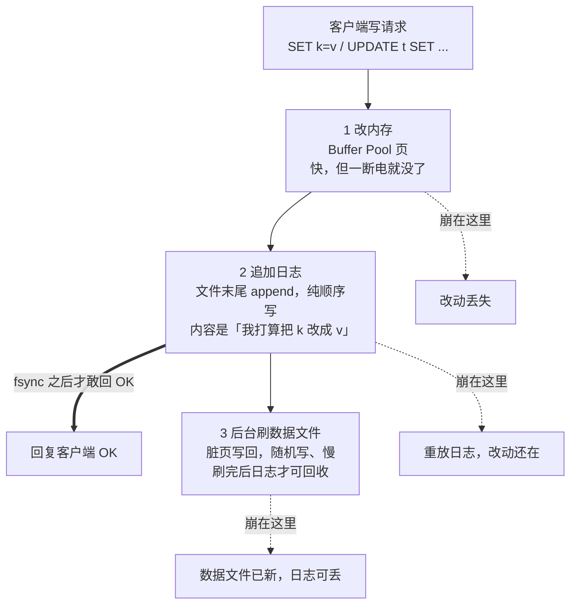
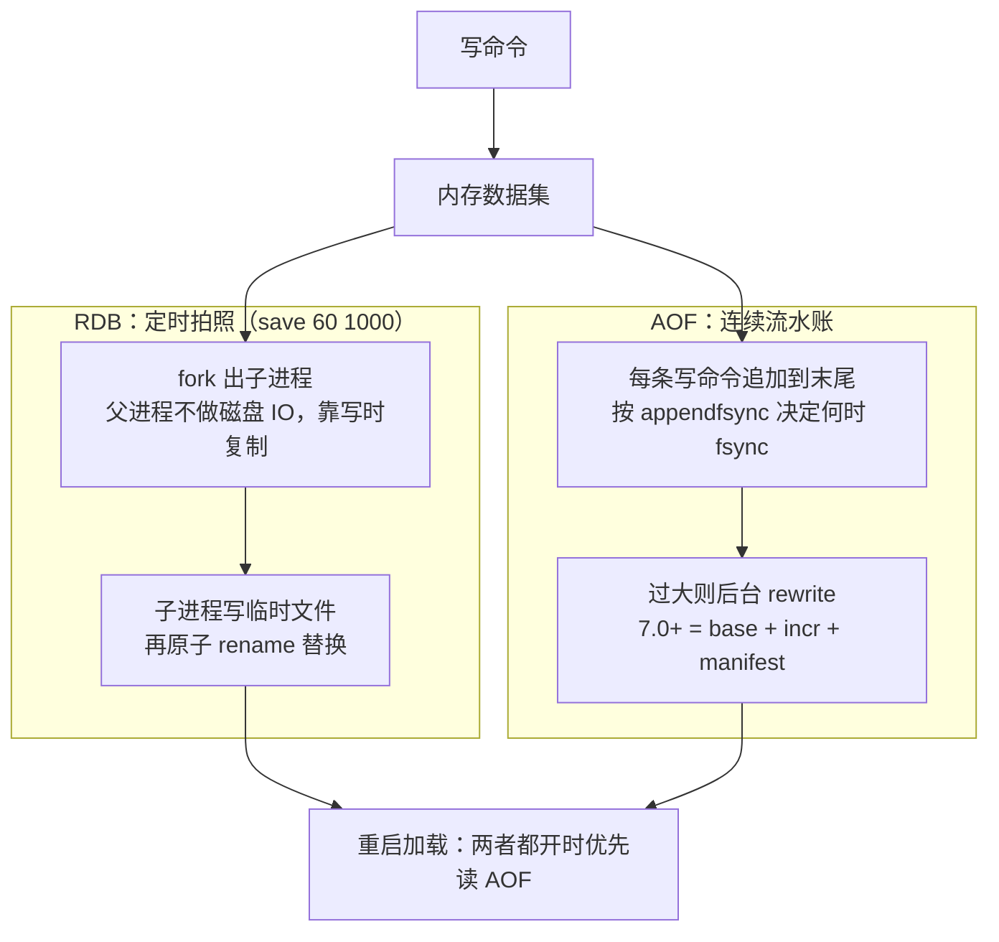
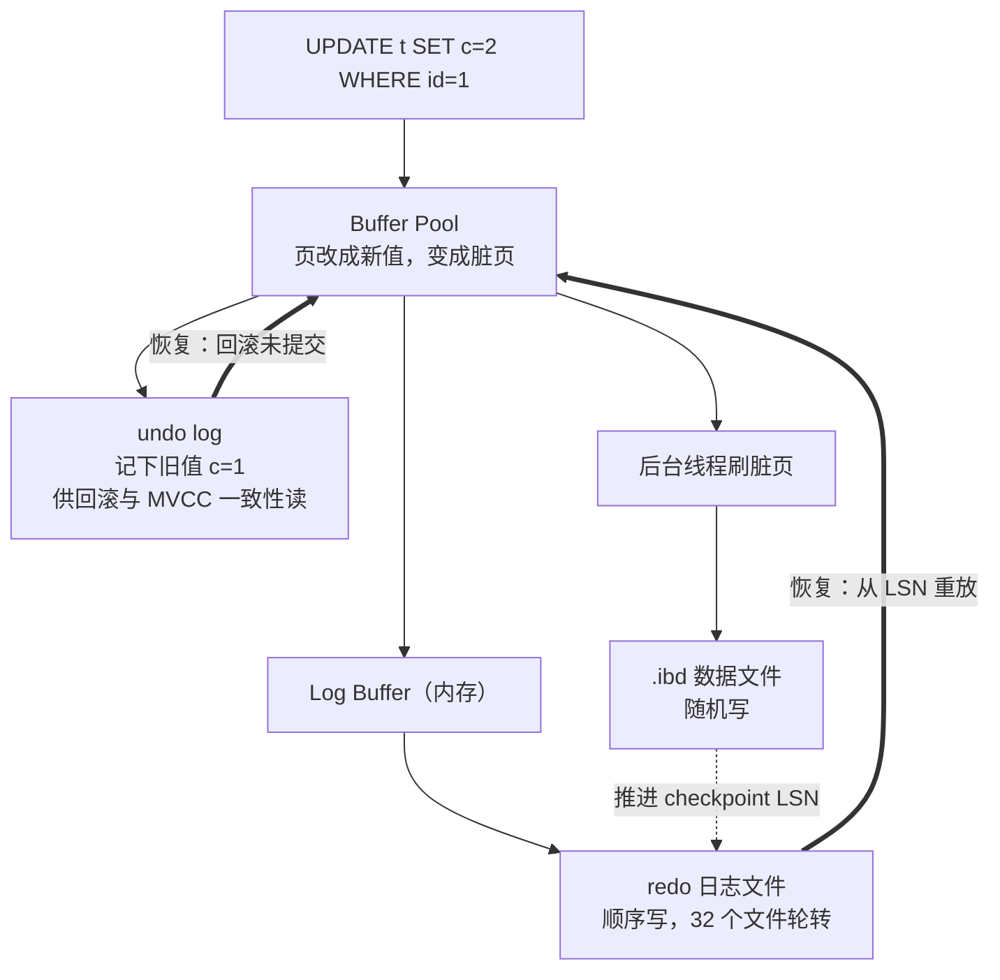
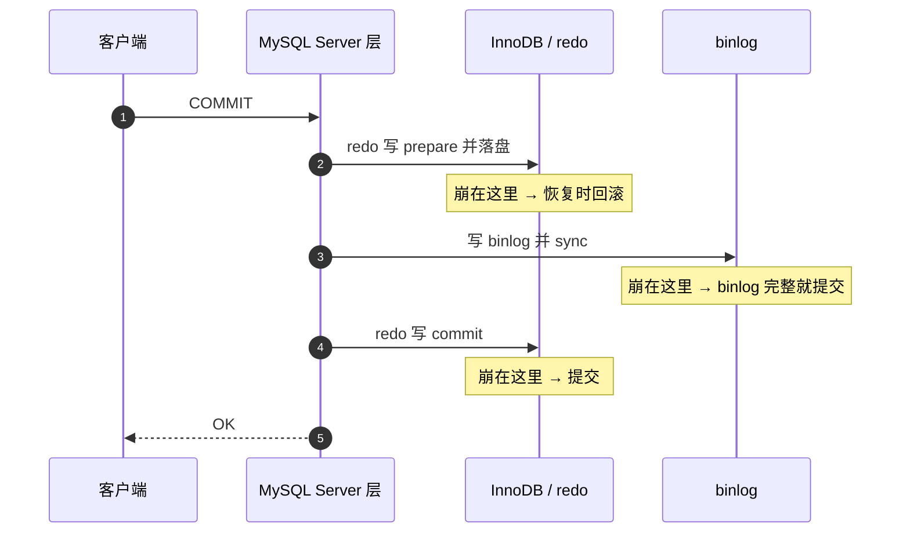
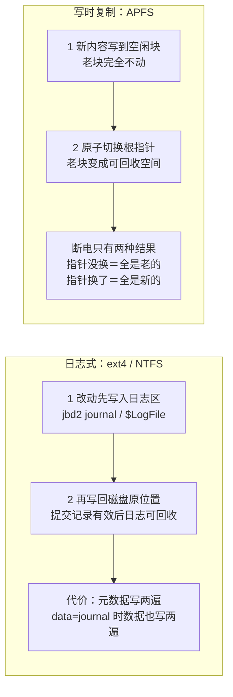
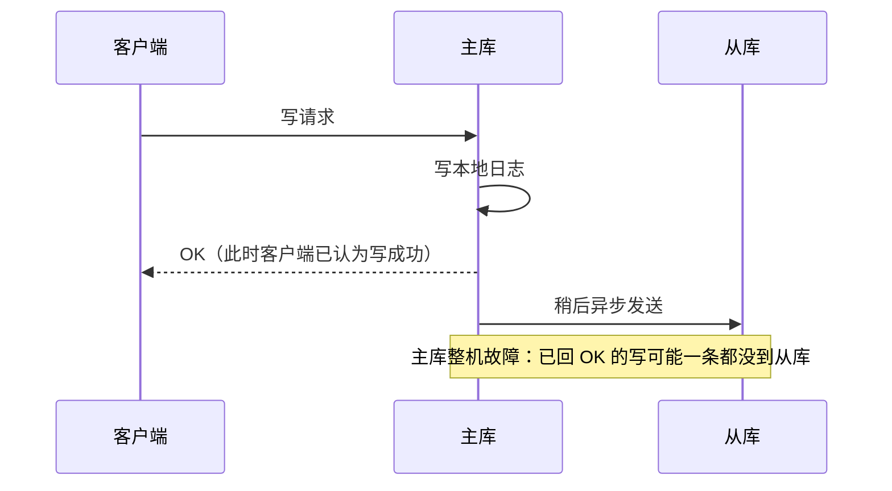
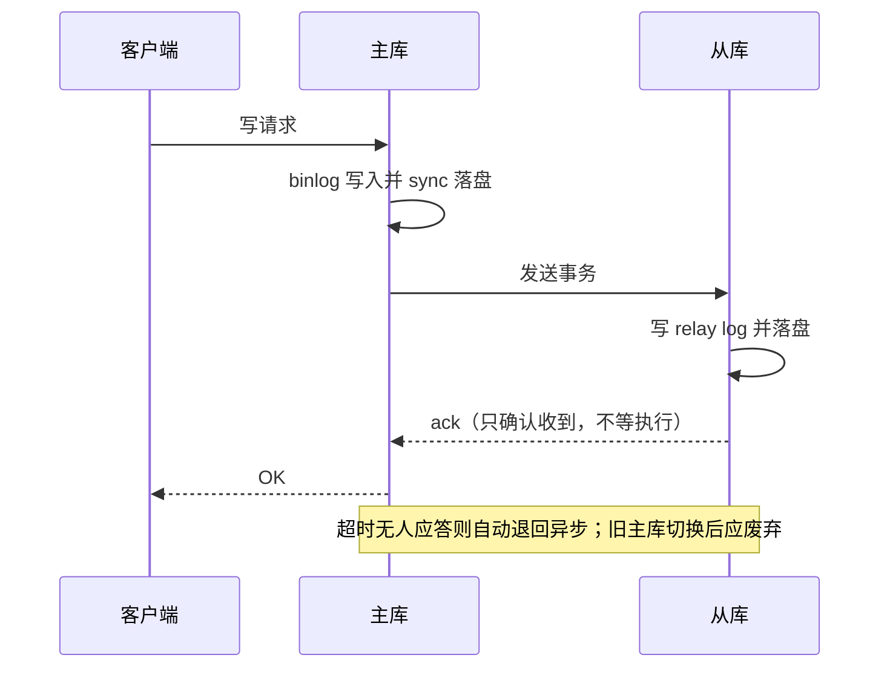
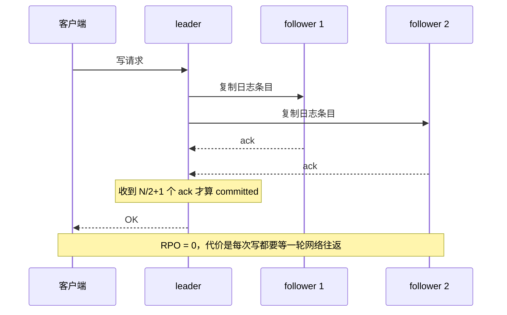

> 覆盖版本：Redis 8.x 文档（redis.io/docs/latest）、MySQL 8.4 LTS、PostgreSQL 17、Linux 内核 ext4 文档（latest）、etcd v3.6<br>
> 核验日期：2026-09-02（本文所有默认值、参数名都按上述官方文档逐条核对过）

## 我想解决的问题

Redis 的 AOF/RDB、MySQL 的 redo log/undo log/binlog、ext4 的 journal、NTFS 的日志文件、APFS 的写时复制，这些名词都单独背过，但从来没串起来过。真正想搞明白的是三个问题：

1. 为什么这些系统不约而同地「先写一个日志文件，再改真正的数据」？绕这一圈图什么？
2. 说「数据已经落盘了」到底是落到哪儿了？为什么有人说 `fsync` 之前的一切都不算数？
3. 崩溃之后到底恢复出什么？集群里多一台机器，能不能让这件事变简单？

## 当前结论

- **这些机制其实是同一套路，叫预写日志（Write-Ahead Logging，WAL）**：改动先以「我打算怎么改」的形式顺序追加到日志里，数据文件慢慢在后台更新。崩了就重放日志。Redis 的 AOF、MySQL 的 redo、PostgreSQL 的 WAL、ext4 的 journal、etcd 的 WAL，是同一个想法的五种口音。
- **快照和日志是互补的，不是二选一**：日志能精确恢复到最后一刻但会越长越大、重放越来越慢；快照小、加载快，但只能恢复到某个时间点。所以几乎所有系统最后都变成「快照 + 快照之后的日志」：Redis 是 RDB + AOF，etcd 是 snapshot + WAL，MySQL 是 checkpoint + redo。
- **`fsync` 是唯一真正的分界线**：`write()` 返回成功只意味着数据交给了操作系统。分界线之前的所有内容都可能在断电时消失，所有「持久化档位」本质上都是在问「多久跨一次这条线」。
- **「持久化」永远是一个可调档位，不是一个布尔值**：Redis 的 `appendfsync`、MySQL 的 `innodb_flush_log_at_trx_commit`、PostgreSQL 的 `synchronous_commit`、ext4 的 `data=` 三模式，本质上都是同一个滑块：性能 ↔ 最多丢多少。
- **单机日志决定「进程崩了能不能恢复」，复制策略决定「机器没了能不能恢复」**。这是两件独立的事：Redis 默认异步复制，主库返回 OK 的写可能一条都还没到从库；MySQL 半同步至少保证有一台从库收到了；Raft 要求多数派确认才算提交。
- **文件系统在做完全相同的事，只是保护对象不同**：ext4 和 NTFS 默认只用日志保护**元数据**（目录结构、inode、位图），不保护你的文件内容；APFS 干脆不写日志，改用写时复制（COW）+ 原子换指针来达到同样的崩溃一致性。
- **最脆弱的一环往往在硬件和内核，不在数据库**：MySQL 官方文档自己就写着「许多操作系统和某些磁盘硬件会欺骗 flush 操作」；PostgreSQL 在 2018 年的 fsyncgate 之后干脆选择 `fsync` 一失败就 PANIC。

## 术语表

| 术语 | 说人话的意思 |
| --- | --- |
| WAL（预写日志） | 先把「要做什么」写进日志，再慢慢改数据文件。所有下面这些系统的共同套路 |
| redo / undo | redo = 重做（已提交的改动崩溃后补上）；undo = 撤销（没提交的改动崩溃后抹掉） |
| 快照（snapshot） | 某一时刻全部数据的完整副本，如 Redis 的 RDB 文件 |
| 脏页（dirty page） | 内存里已改、还没写回磁盘的那一页数据 |
| `fsync` | 一个系统调用，含义是「别缓存了，现在就给我落到盘上」；它返回之前，一切都不算数 |
| page cache | 内核里替所有文件读写做缓存的那一层内存；进程崩了它还在，机器断电它就没了 |
| checkpoint | 「到这里为止的改动都已经进数据文件了」的一个标记；标记之前的日志可以丢掉 |
| LSN | 日志序列号，日志里每条记录的递增编号，用来判断新旧和续接 |
| journal（日志区） | 文件系统里那块专门放「即将发生的改动」的区域，如 ext4 的 jbd2、NTFS 的 `$LogFile` |
| COW（写时复制） | 改数据时不动原块，写一个新块，最后原子地把指针指过去 |
| 幂等重放 | 同一条日志重放两次结果不变；这是崩溃恢复敢反复重放的前提 |
| RPO | Recovery Point Objective，出事后最多能接受丢多少（通常按时间算，如「最多丢 1 秒」） |

## 1. 一条主线：为什么大家都先写日志

先讲一个记账的类比，本文后面所有系统都用这一套比喻。

你是一家店的记账员。正式账本很厚，每笔账要翻到对应页、找到对应行、擦掉旧数字写新数字，**慢**。于是你的做法是：柜台上放一张流水纸，来一笔就在末尾追一行「张三付了 100」，**快**；等打烊之后再慢慢誊进正式账本。

这里有三个关键点，正好对应工程上的三个理由：

1. **顺序写比随机写快得多**。流水纸只往末尾加，账本要到处翻。磁盘也一样：追加是顺序 IO，改数据文件是随机 IO。PostgreSQL 文档的说法是，用了 WAL 之后「只需要把 WAL 文件刷到磁盘就能保证事务已提交，而不需要刷所有被改动的数据文件」。
2. **日志记的是「意图」，数据文件存的是「结果」**。意图很小（改了哪几个字节），结果很大（一整页 16 KB）。写小的那个更划算。
3. **有了流水纸就敢晚点誊账本**。中途着火（崩溃）也不怕：重新开门时照着流水纸把还没誊的重做一遍就行。

```text
   客户端: SET k=v / UPDATE t SET ...
        |
        v
  [1] 改内存          内存里的数据结构 / InnoDB Buffer Pool 页
        |             (快, 但一断电就没了)
        v
  [2] 追加日志        日志文件末尾 append, 纯顺序写
        |             内容是"我打算把 k 改成 v"
        v
  ===== fsync 分界线 =================================
        |             过了这条线, 才敢对客户端说 "OK"
        v
  [3] 后台刷数据      把脏页写回数据文件, 随机写, 慢
                      刷完之后日志才可以回收(checkpoint)

  崩溃点            重启之后的结果
  ---------------   ------------------------------------
  在 [1] 之后       改动丢失, 等于这次写没发生过
  在 [2] 之后       日志里有记录 -> 重放, 改动还在
  在 [3] 之后       数据文件已是新的, 那段日志可以丢
```

一句话总结全文：**下面所有系统的差别，只是这张图上各个方框叫什么名字，以及那条 `fsync` 分界线画在哪。**

## 2. Redis：RDB 是拍照，AOF 是流水账

Redis 全部数据在内存里，所以持久化对它来说是纯粹的「往外倒」。它给了两种倒法，可以单用也可以一起用。

### 2.1 两种方式的分工

```text
  写命令 -> 内存数据集 -+
                        |
     +------------------+---------------------+
     |                                        |
     v  RDB (快照 = 拍照)                     v  AOF (日志 = 流水账)
  满足 save 规则时(如 save 60 1000):      每条写命令追加到文件末尾
    fork 出子进程                          appendfsync 决定何时 fsync
    子进程写临时 rdb 文件 -> 原子 rename    文件越来越大
    父进程一点磁盘 IO 都不做(靠 COW)         -> 后台 rewrite 压缩

  两者都开时, 重启优先加载 AOF (官方原话: AOF 内容保证最全)
```

- **RDB** 是某一时刻的全量二进制快照。生成方式是 `fork()` 出子进程，子进程负责写盘，父进程继续服务，靠操作系统的写时复制拿到一个「凝固」的内存视图。代价是数据集很大时 `fork()` 本身可能卡住主进程几毫秒到一秒。
- **AOF** 记录每条改数据的命令，用的就是 Redis 协议本身的格式，重启时按顺序重放一遍。默认**不开启**，要显式 `appendonly yes`。
- **AOF 重写**：一个计数器加了 100 次，AOF 里就有 100 条记录，但重建状态只需要 1 条。所以 Redis 会在后台生成一份「能重建当前数据集的最短命令序列」替换掉旧文件。Redis 7.0 起 AOF 变成多文件结构（multi-part AOF）：一个 base 文件（快照，可以是 RDB 格式）+ 若干 incr 增量文件 + 一个 manifest 清单文件，重写完成时原子替换 manifest 生效。

**注意这个细节**：Redis 7.0 之后的 AOF 自己就长成了「快照 + 增量日志」，和 etcd、和 MySQL 的 checkpoint + redo 完全同构。这不是巧合，是同一个问题的同一个最优解。

### 2.2 `appendfsync`：三个档位就是三条分界线

| 档位 | 行为 | 最多丢多少 | 什么时候用 |
| --- | --- | --- | --- |
| `always` | 每批命令写完就 `fsync` 再回复客户端 | 0 | 真的一条都不能丢；官方明说「非常非常慢」，但支持组提交 |
| `everysec`（默认） | 后台线程每秒 `fsync` 一次 | ≤ 1 秒 | **默认且推荐**，快且相对安全 |
| `no` | 从不主动 `fsync`，交给操作系统 | 由内核决定，Linux 上通常 30 秒左右 | 数据可丢的缓存场景 |

官方还有一个容易被忽略的说明：`always` 是在**一批**来自多个客户端或流水线的命令执行完之后才追加并 `fsync` 一次，所以它不是「每条命令一次系统调用」那么惨，但依然是最慢的档。

### 2.3 崩溃恢复与常见坑

- AOF 被**截断**（写到一半断电）：默认 `aof-load-truncated` 开启，Redis 会丢掉最后那条不完整的命令照常启动，并打日志告警。
- AOF 中间**损坏**（出现非法字节）：Redis 拒绝启动，需要 `redis-check-aof --fix` 处理，可能造成从损坏点到文件末尾的大段数据丢失。
- **只有 RDB 的风险**：save 规则通常是分钟级，非正常关闭就要做好丢掉最近几分钟的准备。
- **从 RDB 切到 AOF 千万别直接改配置重启**：官方明确要求先在活着的实例上 `CONFIG SET appendonly yes` 完成转换，再 `CONFIG REWRITE` 落盘配置，否则会丢数据。
- Redis 8.10 起还提供了 `BACKUP` 命令族（`BACKUP START` / `LIST` / `SEAL` / `CLEANUP`），产出的就是 base + incr + manifest 三件套，恢复时用 `preload-file` 指过去。它的价值在于集群里可以错开各节点的 `fork` 时间，不让所有节点同时抖动。

## 3. MySQL/InnoDB：redo 管「已提交不丢」，undo 管「没提交能撤」

这两个名字最容易混。一句话记法：**redo 面向未来（崩溃后把已提交的补上），undo 面向过去（把没提交的抹掉、把旧值给别人看）。**

| | redo log | undo log |
| --- | --- | --- |
| 记什么 | 页级的物理改动：某页某偏移改成了什么 | 逻辑上的反操作：这条记录原来长什么样 |
| 解决什么 | 崩溃后已提交事务不丢（持久性 D） | 回滚 + 一致性读（原子性 A、隔离性 I） |
| 存在哪 | 独立的 redo 文件（8.4 里共 32 个文件轮转） | undo 表空间里的回滚段 |
| 什么时候能扔 | checkpoint 推进过去之后 | 事务结束且没有任何快照还需要看旧版本之后（由 purge 清理） |
| 顺带一提 | 临时表的 undo **不**写 redo，因为崩溃后不需要恢复 | 同一个事务最多分到 4 个 undo log（普通表/临时表 × insert/update-delete） |

undo 的第二重身份最值钱：MVCC 的一致性读。别的事务要看这行的旧版本时，InnoDB 就顺着 undo 记录往回找。所以长事务不提交会让 undo 一直无法清理、表空间膨胀，这条是线上真实故障的常客。

### 3.1 一次 UPDATE 在 InnoDB 里的完整路径

```text
  UPDATE t SET c = 2 WHERE id = 1;
    |
    v
  Buffer Pool: 页改成新值(变脏页)  <---- undo: 同时记下旧值 c=1
    |                                    供回滚 + 其他事务一致性读
    v
  Log Buffer(内存) --> redo 文件(顺序写, 32 个文件轮转使用)
    |                       ^
    |                       | checkpoint LSN 之前的 redo 可以被截断回收
    v                       |
  后台线程把脏页刷回 .ibd 数据文件(随机写) --+

  提交时的两阶段(让 redo 和 binlog 不打架):
    1) redo 写 prepare        --- 崩在这里: 恢复时回滚
    2) binlog 写入并 sync     --- 崩在这里: binlog 完整就提交
    3) redo 写 commit         --- 崩在这里: 提交
```

崩溃恢复时 InnoDB 从**最近一个 checkpoint LSN** 开始扫 redo，把还没进数据文件的改动重放一遍，再用 undo 把没提交的事务回滚掉。官方特意强调：**崩溃恢复的正确性和 `innodb_flush_log_at_trx_commit` 怎么设无关**，事务要么整个生效、要么整个消失，区别只在于「最后几个已回 OK 的事务还在不在」。

### 3.2 `innodb_flush_log_at_trx_commit`：又是三个档位

| 值 | 行为（官方原文口径） | 最多丢多少 |
| --- | --- | --- |
| `0` | 日志每秒写一次并刷盘；提交时什么都不做 | 约 1 秒的已提交事务 |
| `1`（默认） | 每次提交都写入并刷盘 | 0（完整 ACID 要求这一档） |
| `2` | 每次提交都写入（到操作系统），每秒刷一次盘 | 约 1 秒；但 MySQL 进程崩溃不丢，只有整机断电才丢 |

配套的两条：

- 「每秒」这个周期由 `innodb_flush_log_at_timeout` 控制（默认 1 秒，可设到 2700 秒）。官方也承认这个周期**不保证精确**：DDL 等内部活动会导致更频繁的刷，调度问题会导致更稀疏。
- 想要复制场景下最强的持久性和一致性，官方建议 `innodb_flush_log_at_trx_commit=1` 搭配 `sync_binlog=1`。

**0 和 2 的差别值得单独记**：设成 2 时数据已经交给了操作系统的 page cache，所以 `mysqld` 进程崩溃（甚至被 kill）不会丢数据，只有整机断电才丢；设成 0 时数据还在 MySQL 自己的 log buffer 里，进程一崩就没了。这对应第 5 节那张四层图上的两级台阶。

### 3.3 binlog：不是给崩溃恢复用的

redo 是 InnoDB 私有的、物理的、循环写的；binlog 是 MySQL Server 层的、逻辑的、追加写的，用途是**复制和恢复到时间点**，不参与崩溃重放。MySQL 8.4 的相关默认值：

- 二进制日志**默认开启**（无论有没有写 `--log-bin`），只有手工 `--initialize` 初始化数据目录时才默认关闭。
- `binlog_format` 默认 `ROW`，而且这个变量本身已被标记为 deprecated，言下之意是非行级格式将来会被移除，新架的复制一律用 ROW。
- `sync_binlog=1` 表示每次提交都把 binlog 刷盘（8.0 起的默认值；设为 N 表示每 N 次事务刷一次，设 0 完全交给操作系统）。

因为有两份日志，MySQL 必须保证「redo 认为提交了」和「binlog 里有这条」不出现分歧，否则主从数据会永久漂移，这就是上面那个两阶段提交存在的唯一理由。

## 4. 文件系统：同一个套路，换了个场地

这里最反直觉的一点先说：**ext4 和 NTFS 默认保护的是文件系统自己的元数据，不是你的文件内容。**「崩溃后文件系统是一致的」和「崩溃后你的文件内容是完整的」是两个不同的承诺，日志式文件系统默认只给前一个。

### 4.1 两种流派

```text
  日志式(ext4 / NTFS)                COW 式(APFS / ZFS / Btrfs)

  1. 先把改动写进日志区              1. 新内容写到空闲块(不碰老块)
     +------------------+              +--------+     +--------+
     | journal: 元数据   |              |  老块  |     |  新块  |
     +------------------+              +--------+     +--------+
  2. 再把改动写回原位                2. 最后原子地把指针指向新块
     +------------------+                 root --X--> 老块
     | 原位: inode/位图  |                 root ----> 新块
     +------------------+
  3. 提交记录有效 -> 日志可回收      3. 断电只有两种结果:
                                        指针没换 = 全是老的
  代价: 元数据要写两遍                   指针换了 = 全是新的
  (data=journal 时数据也写两遍)       代价: 碎片 / 需要空间回收
```

日志式的恢复逻辑和数据库一模一样：内核文档写得很直白：重放日志可以一直放到**最后一条有效的 commit 记录**，只有校验和匹配、带有效提交记录的事务才会被重放，其余丢弃。

### 4.2 三家对照

| | ext4（Linux） | NTFS（Windows） | APFS（macOS） |
| --- | --- | --- | --- |
| 机制 | jbd2 日志（journal） | 事务式日志文件 `$LogFile` + checkpoint 信息 | 写时复制元数据，**不用日志** |
| 默认保护 | 仅元数据（`data=ordered`） | 元数据；官方表述为「基于事务的日志文件和检查点信息」 | 元数据；官方称「不需要 journaling 的写两遍开销」 |
| 崩溃恢复 | 挂载时重放日志到最后一条有效 commit | 下次启动时自动用日志恢复一致性，另有 self-healing NTFS 与在线 `chkdsk` | 要么看到完整的新状态，要么看到旧状态 |
| 可调档 | `data=journal` / `ordered`（默认）/ `writeback` | 无对应的用户可调模式 | 无 |
| 附带能力 | fast commit（ordered 模式下减少延迟） | 坏扇区动态重映射、CSV 集群共享卷 | 快照、克隆、空间共享、atomic safe-save |

ext4 三种模式的含义（内核文档原文口径）：

| 模式 | 含义 | 结果 |
| --- | --- | --- |
| `data=journal` | 数据和元数据都过日志 | 最安全，最慢，全部内容写两遍 |
| `data=ordered`（默认） | 只有元数据过日志，但保证数据块先于元数据落盘 | 折中；崩溃后不会出现「元数据指向一块没写完的垃圾数据」 |
| `data=writeback` | 只有元数据过日志，数据块顺序不保证 | 最快；崩溃后可能读到旧内容甚至别人的残留数据 |

APFS 的选择最值得玩味。Apple 的说法是：用一套写时复制的元数据方案来保证崩溃保护，**从而省掉 journaling 那份「写两遍」的开销**；配套的还有原子安全保存（atomic safe-save）原语。Apple 还在 FAQ 里解释了为什么不写冗余元数据副本：在闪存上，写两个块并不能保证它们落在不同的物理位置，FTL 通常会把同时写入的内容编进同一个 NAND 块，所以第二份副本给不了额外保护。这条对理解「SSD 时代的持久化」很有启发：**很多为机械盘设计的可靠性技巧，在闪存上是失效的。**

### 4.3 对应用开发者的实际影响

写文件想要「要么是老版本、要么是新版本，绝不出现半新半旧」，在任何文件系统上都得自己做，标准做法是：

```text
1. 写临时文件 tmp
2. fsync(tmp)            <- 内容真正落盘
3. rename(tmp, target)   <- 同名替换是原子的
4. fsync(目录)            <- 让"目录里现在指向新文件"这件事也落盘
```

第 2 步和第 4 步经常被漏掉，然后在断电测试里表现为「文件在，但里面是 0 字节」。Redis 写 RDB 用的正是这个套路（临时名 + 原子 `rename`），所以官方才敢说运行中直接拷贝 RDB 文件是安全的。

## 5. `fsync` 的真相：以为写了，其实没写

前面反复出现的那条分界线，展开看其实有四层，每一层都能让你误以为数据已经安全了。

```text
  你的 write() 调用
        |
        v
  [1] 应用自己的缓冲区      (Redis 的 AOF buffer / InnoDB 的 log buffer)
        |  write() 之后离开这层
        v
  [2] 操作系统 page cache   (内核里的脏页; 进程崩了它还在,
        |                    整机断电就没了)
        |  fsync()/fdatasync() 之后离开这层
        v
  [3] 磁盘自带的缓存        (盘上的 DRAM; 没有掉电保护就会丢)
        |  write barrier / FUA / 强制 flush 之后离开这层
        v
  [4] 真正的介质(盘片 / NAND)   到这一层才算"落地"

  各档配置停在哪一层:
    appendfsync no                      停在 [2], 由内核决定何时推进
    appendfsync everysec                每秒推进到 [3]/[4]
    appendfsync always                  每批命令推进到 [3]/[4]
    innodb_flush_log_at_trx_commit = 0  停在 [1], 每秒推进
    innodb_flush_log_at_trx_commit = 2  停在 [2], 每秒推进
    innodb_flush_log_at_trx_commit = 1  提交即推进到 [3]/[4]
    synchronous_commit = off (PG)       停在 [2], 最多滞后 3×wal_writer_delay
```

三个必须知道的坑：

1. **硬件会撒谎**。MySQL 官方文档在讲这个参数时专门加了一段警告：许多操作系统和某些磁盘硬件会「欺骗」flush 操作，告诉 `mysqld` 已经刷盘了其实并没有，这种情况下即使设了推荐值，断电依然可能损坏数据。企业级 SSD 用掉电保护电容解决这个问题，消费级的通常没有。
2. **`fsync` 失败只会告诉你一次**（fsyncgate，2018）。内核在回写脏页失败后可能把页标记为干净，于是**下一次 `fsync` 会成功返回**，而那份数据已经永久丢了。Linux 4.13 以前错误会以各种方式丢失；4.13 到 4.15 只报告文件打开之后发生的错误；4.16+ 错误计数器能跨 close/open 存活，但**依然只报一次**。PostgreSQL 的应对是：`fsync` 一失败就 PANIC 走崩溃恢复，而不是假设重试能成功。这个补丁回补到了当时所有支持版本。
   **应用侧的教训**：`fsync` 返回 `EIO` 之后重试是没有意义的，正确反应是当作「这份数据可能已经没了」来处理。
3. **`fdatasync` 比 `fsync` 便宜**，因为它不保证刷元数据（比如修改时间）。日志文件预分配好大小之后，写日志只需要 `fdatasync`，PostgreSQL 在 Linux 上的 `wal_sync_method` 默认就是 `fdatasync`。

## 6. 集群：把本机日志寄给别人

单机日志的上限是「机器还在」。硬盘烧了、机房断网，日志再全也读不到。集群解决的是另一个问题，而它的做法依然是**把同一份日志复制一遍**：Redis 复制的是命令流，MySQL 复制的是 binlog，etcd 复制的是 Raft log。

真正的区别只有一个：**主库在什么时候回复客户端 OK。**

```text
  异步 (Redis 默认 / MySQL 默认复制)
    client --写--> 主库 --写本地日志--> [OK 返回客户端]
                          \---稍后---> 从库
    主库整机挂掉: 已经回 OK 的写可能一条都没到从库

  半同步 (MySQL, 默认 AFTER_SYNC)
    client --写--> 主库 --binlog 落盘--> 从库写 relay log 并落盘
                                             |
                          [OK 返回客户端] <---+ ack
    至少一台从库收到了这条事务; 超时则自动退回异步

  多数派 (etcd/Raft, MySQL Group Replication)
    client --写--> leader --> follower1 ack
                          --> follower2 ack
                    收到 N/2+1 个 ack 才算 committed
                          [OK 返回客户端]
```

**Redis：异步，而且官方从不假装不是。** 文档原话是 Redis 默认使用异步复制。`WAIT` 命令可以要求「等到 N 个副本确认」，但官方同时说明：`WAIT` **不能**把 Redis 变成强一致的 CP 系统，已确认的写在故障转移中仍可能丢失，取决于持久化配置，它只是把丢数据的概率压到很难触发的窗口里。另有 `min-replicas-to-write` / `min-replicas-max-lag`：从库数量不足或延迟太大时主库直接拒绝写入，官方称之为「尽力而为的数据安全机制」，把无界的数据丢失变成有界的。

还有一个经典事故模式值得单独记（官方文档里专门画了出来）：主库关掉持久化 + 开启自动重启 = 数据被全网抹掉。主库崩溃后被拉起，数据集是空的，从库老老实实同步了这个空数据集，三份数据一起没了。**所以主库关持久化时，必须同时关掉自动重启。**

**MySQL 半同步**：主库等的是从库「**收到并写入 relay log 且落盘**」的确认，**不等**从库执行完。默认等待点 `AFTER_SYNC` 表示在 binlog 落盘之后、存储引擎提交之前等 ack。默认只要 1 个 ack。超时没人应答就自动降级成异步，等有从库跟上再升回来。官方还有一条运维铁律：半同步下主库崩溃并发生切换后，**旧主库不能再作为复制源使用，应该直接废弃**，它可能持有没被任何从库确认、但本地已经写下的事务。

**etcd/Raft**：日志条目要先被多数派持久化才算 committed，然后才应用到状态机。etcd 的磁盘布局正好是本文主线的最纯净形态：WAL 文件（默认保留约 5 个、每个约 64 MB，追加写，从不原地修改）+ 每约 10 万条已应用提案生成一个快照。重启时先装载最新快照，再重放快照之后的 WAL。只有 index ≤ `HardState.commit` 的条目才被认为是最终的。

代价也要说清楚：多数派意味着**每次写都要等一轮网络往返**，所以 etcd 存的是配置和元数据（KB 级），不是业务数据（TB 级）。

## 7. 对照参考：PostgreSQL 与 etcd

放在一起看，能确认「这真的是同一个套路」。

**PostgreSQL** 是 WAL 这个词最正统的用法，机制和 InnoDB redo 高度相似，但有两处关键差别：

- **PG 没有独立的 undo**。旧版本的行直接留在数据页里（堆内多版本），所以 PG 需要 VACUUM 来回收死元组，而 InnoDB 需要 purge 来清理 undo。「长事务导致膨胀」这个症状两边都有，病灶位置不同。
- **`full_page_writes`（默认 on）**：checkpoint 之后第一次修改某页时，把整页写进 WAL。这是为了防止「页写了一半就断电」导致的坏页：数据库页 8 KB/16 KB，磁盘扇区 512 B/4 KB，中间断电就会出现半新半旧的页。InnoDB 解决同一问题用的是 doublewrite buffer，思路不同、目的相同。

PG 的持久化档位是 `synchronous_commit`（默认 `on`），它比前面几个都细，因为把本地和远程串在了一根滑块上：

| 值 | 等到哪一步才回客户端 |
| --- | --- |
| `off` | 不等 WAL 落盘就返回（最多滞后 3 × `wal_writer_delay`，默认 200 ms） |
| `local` | 本地 WAL 落盘 |
| `remote_write` | 备库收到并写入其操作系统 |
| `on`（默认） | 备库把 WAL 刷到持久存储 |
| `remote_apply` | 备库应用完毕（读备库能立刻看到） |

官方对 `off` 的定性很精确，值得原样记住：它和关掉 `fsync` **不一样**，不会造成数据库不一致，崩溃时只是丢掉最近一些「看似已提交」的事务，数据库状态等同于这些事务被干净地回滚了。而关掉 `fsync` 会导致不可恢复的数据损坏。**丢事务和坏数据库，是两个数量级的事故。**

**etcd** 已在第 6 节讲过，这里只留一句对照：它把「日志 + 快照 + 多数派确认」三件事做成了最小可读的形态，是理解这套机制最好的教材级实现。

## 8. 横向对比总表

| 系统 | 日志叫什么 | 快照叫什么 | 刷盘档位参数 | 默认最多丢多少 | 恢复方式 | 复制怎么走 |
| --- | --- | --- | --- | --- | --- | --- |
| Redis | AOF（7.0+ 为 base + incr 多文件） | RDB | `appendfsync`（默认 `everysec`） | 开 AOF：≤1 秒；只开 RDB：一个 save 周期（常为分钟级） | 重放 AOF（两者都开时优先 AOF） | 异步；`WAIT` 只降低概率不保证 |
| MySQL/InnoDB | redo log（+ undo log 负责回滚与 MVCC） | checkpoint 之后的数据文件本身 | `innodb_flush_log_at_trx_commit`（默认 `1`） | 默认档 0 | 从 checkpoint LSN 重放 redo，再用 undo 回滚未提交事务 | binlog；异步 / 半同步（`AFTER_SYNC`）/ MGR 多数派 |
| PostgreSQL | WAL | 基础备份 + checkpoint | `synchronous_commit`（默认 `on`） | 默认档 0 | 从最近 checkpoint 重放 WAL | 流复制，档位与 `synchronous_commit` 共用一根滑块 |
| ext4 | jbd2 journal | 无 | `data=journal/ordered/writeback`（默认 `ordered`） | 元数据不丢；**文件内容默认不保证** | 挂载时重放到最后一条有效 commit | 无（靠上层 DRBD/分布式文件系统） |
| NTFS | `$LogFile`（事务日志 + checkpoint） | 无（VSS 快照在上层） | 无用户可调档 | 元数据不丢；文件内容不保证 | 启动时自动恢复一致性；self-healing / 在线 `chkdsk` | 无（靠 CSV / 存储层） |
| APFS | 无日志，改用 COW 元数据 | 原生快照（snapshot） | 无用户可调档 | 元数据一致；文件内容需应用自己 `fsync` | 天然崩溃一致：要么全新、要么全旧 | 无 |
| etcd | Raft WAL | `*.snap`（约每 10 万条提案） | 提交即 fsync（Raft 要求） | 0（多数派确认后才算提交） | 装载最新快照 + 重放其后的 WAL | Raft 多数派 |

## 9. 怎么给自己的系统选档

选档只需要回答一个问题：**这份数据丢 1 秒，会怎么样？**

| 场景 | 建议 | 理由 |
| --- | --- | --- |
| 纯缓存（可以丢，回源就能重建） | Redis：只留 RDB 或干脆关掉持久化；`appendfsync no` 也可接受 | 丢了从数据库回源即可；把 IO 全留给吞吐。注意：主库关持久化时**必须**关掉自动重启 |
| 会话、购物车、计数器（丢了不致命但会被投诉） | Redis：AOF + `everysec` + 至少一个从库；加 `min-replicas-to-write 1` | 默认档就是为这类场景设计的：≤1 秒的有界损失 |
| 订单、支付、账务（一条都不能丢） | MySQL：`innodb_flush_log_at_trx_commit=1` + `sync_binlog=1` + 半同步（`AFTER_SYNC`）；预算允许时用 MGR/多数派 | 这是官方给出的「最强持久性与一致性」组合。可靠性要买单：每次提交至少一次 `fsync` + 一次网络往返 |
| 日志/埋点/可回放的分析数据 | MySQL：`innodb_flush_log_at_trx_commit=2` + `sync_binlog=1000`；或直接写对象存储 | 数据源头可重放，追求吞吐。选 `2` 而不是 `0`，这样 MySQL 进程崩溃不丢数据，只有整机断电才丢 |
| 配置、服务发现、选主 | etcd 这类多数派系统，别用 MySQL 硬凑 | 数据量小、一致性要求极高，正是 Raft 的主场 |

三条通用建议：

1. **先量化 RPO 再调参数**。「最多丢 1 秒」是一句可以拿去和业务对齐的话，「性能优先」不是。
2. **单机档位和复制策略要一起选**。`innodb_flush_log_at_trx_commit=1` 配异步复制，主库整机故障时该丢照样丢；`appendfsync always` 配单实例，机器没了就全没了。
3. **做一次断电演练**。真的对着虚拟机 `kill -9` 和硬关机各来一次，比读十篇文章都有用。这也是验证「硬件有没有撒谎」的唯一方法。

## 附录：Mermaid 版配图

正文里的 ASCII 图是为了纯文本环境可读；这里给出同样内容的 Mermaid 版本，GitHub、Obsidian、Typora、VS Code 预览都能直接渲染，也方便复制到别处二次编辑。图号与正文小节一一对应。

### 图 1：WAL 主线（对应第 1 节）



### 图 2：Redis 的 RDB 与 AOF（对应第 2 节）



`appendfsync` 三档（正文 2.2 的表格再放一次，配图看）：

| 档位 | 何时 fsync | 最多丢多少 |
| --- | --- | --- |
| `always` | 每批命令写完 | 0 |
| `everysec`（默认） | 后台线程每秒一次 | ≤ 1 秒 |
| `no` | 从不主动，交给内核 | 由内核决定（Linux 常见约 30 秒） |

### 图 3a：InnoDB 的数据路径（对应第 3 节）



### 图 3b：redo 与 binlog 的两阶段提交（对应第 3.1 节）



### 图 4：日志式 vs 写时复制（对应第 4 节）



ext4 三种模式：

| 模式 | 过日志的内容 | 崩溃后果 |
| --- | --- | --- |
| `data=journal` | 数据 + 元数据 | 最安全、最慢，全部写两遍 |
| `data=ordered`（默认） | 仅元数据，但保证数据块先落盘 | 不会出现元数据指向半截数据 |
| `data=writeback` | 仅元数据，不保证顺序 | 可能读到旧内容甚至残留数据 |

### 图 5：四层缓冲阶梯（对应第 5 节）

```text
  你的 write() 调用
       |
       v
  [1] 应用自己的缓冲区
      Redis AOF buffer / InnoDB log buffer
      停在这层: 进程一崩就丢
       |
       |  write() 之后离开这层
       v
  [2] 操作系统 page cache
      内核里的脏页
      停在这层: 进程崩不丢, 整机断电才丢
       |
       |  fsync() / fdatasync() 之后离开这层
       v
  [3] 磁盘自带缓存
      盘上的 DRAM
      停在这层: 盘没有掉电保护就会丢
       |
       |  write barrier / FUA 强制刷下去
       v
  [4] 真正的介质
      盘片 / NAND, 到这才算落地
```

各配置档位停在第几层：

| 配置 | 停在哪一层 | 什么情况下会丢 |
| --- | --- | --- |
| `appendfsync no` | 第 2 层 | 整机断电，丢多少由内核决定 |
| `appendfsync everysec`（Redis 默认） | 每秒推进到第 3/4 层 | 整机断电，≤ 1 秒 |
| `appendfsync always` | 每批命令推进到第 3/4 层 | 只剩硬件撒谎的风险 |
| `innodb_flush_log_at_trx_commit=0` | 第 1 层，每秒推进 | **进程崩溃即丢**约 1 秒 |
| `innodb_flush_log_at_trx_commit=2` | 第 2 层，每秒推进 | 进程崩溃不丢；整机断电丢约 1 秒 |
| `innodb_flush_log_at_trx_commit=1`（默认） | 提交即推进到第 3/4 层 | 0 |
| `synchronous_commit=off`（PG） | 第 2 层 | 最多滞后 3 × `wal_writer_delay`（默认 200 ms） |

### 图 6a：异步复制（Redis 默认 / MySQL 默认）



### 图 6b：半同步复制（MySQL，默认 AFTER_SYNC）



### 图 6c：多数派确认（etcd/Raft、MySQL Group Replication）



### 一条链看懂全文（各家机制的同构关系）

前面六张图讲的其实是同一条链：

```text
改内存 -> 顺序追加日志 -> fsync 分界线 -> 后台刷数据文件 -> 崩溃后重放日志
```

各家往这条链上填的东西：

| 系统 | 机制 | 关键参数或特点 |
|---|---|---|
| Redis | AOF + RDB 快照 | `appendfsync` |
| MySQL / InnoDB | redo + undo + checkpoint | `innodb_flush_log_at_trx_commit` |
| PostgreSQL | WAL + checkpoint | `synchronous_commit` |
| ext4 / NTFS | journal + checkpoint | 只保护元数据 |
| APFS | 不写日志 | COW + 原子换指针 |
| etcd | Raft WAL + snapshot | 多数派确认 |

## 尚未解决

- Redis 8.x 中 `aof-use-rdb-preamble`、默认 `save` 规则、`auto-aof-rewrite-percentage` 的具体默认值本文未逐条核对，只核对了 `appendfsync` 与多文件 AOF 结构。用到时以本机 `CONFIG GET` 为准。
- MySQL redo/binlog 两阶段提交的细节（内部 XA、`binlog_order_commits`、组提交队列）在官方手册中较分散，本文按通行描述给出，未逐句引用原文。
- InnoDB doublewrite buffer 与 PostgreSQL `full_page_writes` 的对照只点到为止，「半页写」的完整机理值得单独一篇。
- 没有做实测：断电/`kill -9` 场景下各档位的实际丢失量、`appendfsync always` 与 `everysec` 的吞吐差距，都缺自己的数据。
- 未覆盖：LSM-tree 系（RocksDB / LevelDB / HBase）的 WAL + memtable + SSTable，其实是本文主线的又一个变体；ZFS/Btrfs 的 COW 与 APFS 的异同；云盘（EBS 等）在这套模型里到底处在哪一层。
- NTFS「只记录元数据、不保护文件内容」这一点，微软公开文档只说了「基于事务的日志文件」，没有明确表述覆盖范围，本文结论来自通行的技术共识，尚未找到官方原文佐证。

## 参考资料

核验日期 2026-09-02。默认值和参数名按这些文档核对。

- [Redis persistence](https://redis.io/docs/latest/operate/oss_and_stack/management/persistence/)
- [Redis replication](https://redis.io/docs/latest/operate/oss_and_stack/management/replication/)
- [MySQL 8.4 InnoDB redo log](https://dev.mysql.com/doc/refman/8.4/en/innodb-redo-log.html)
- [MySQL 8.4 InnoDB undo logs](https://dev.mysql.com/doc/refman/8.4/en/innodb-undo-logs.html)
- [MySQL 8.4 InnoDB parameters](https://dev.mysql.com/doc/refman/8.4/en/innodb-parameters.html)
- [MySQL 8.4 semisynchronous replication](https://dev.mysql.com/doc/refman/8.4/en/replication-semisync.html)
- [MySQL 8.4 binary log options](https://dev.mysql.com/doc/refman/8.4/en/replication-options-binary-log.html)
- [ext4 journal](https://www.kernel.org/doc/html/latest/filesystems/ext4/journal.html)
- [NTFS overview](https://learn.microsoft.com/en-us/windows-server/storage/file-server/ntfs-overview)
- [Apple File System features](https://developer.apple.com/library/archive/documentation/FileManagement/Conceptual/APFS_Guide/Features/Features.html)
- [Role of Apple File System](https://support.apple.com/guide/security/role-of-apple-file-system-seca6147599e/web)
- [PostgreSQL 17 WAL](https://www.postgresql.org/docs/17/wal-intro.html)
- [PostgreSQL 17 WAL configuration](https://www.postgresql.org/docs/17/runtime-config-wal.html)
- [PostgreSQL Fsync Errors](https://wiki.postgresql.org/wiki/Fsync_Errors)
- [etcd persistent storage](https://etcd.io/docs/v3.6/learning/persistent-storage-files/)
